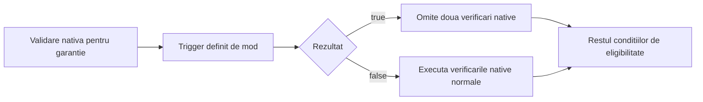

# Callback de script consultat de o rutina nativa HOI4

Verificat pe 2026-11-09, buildul local `1.19.4.2.2da5`.

Exista un exemplu concret al mecanismului cautat: motorul consulta o implementare
de script furnizata prin fisiere de mod si foloseste rezultatul pentru a omite
anumite verificari native. Exemplul verificat este eligibilitatea acordarii
unei garantii. Nu este o interfata generala pentru inlocuirea oricarei functii C++.

## Punctul de extensie

Fisierul virtual este
`common/scripted_triggers/diplomacy_scripted_triggers.txt`, iar numele este:

```text
DIPLOMACY_GUARANTEE_ENABLE_TRIGGER_OVERRIDES_GAME_TRIGGER = {
    always = yes
}
```

In proba s-a suprascris exact fisierul virtual existent, pastrand celelalte
definitii si schimband numai corpul acestui trigger. Nu s-a presupus o regula
neverificata de prioritate pentru definitii duplicate din alte fisiere.
Valoarea constanta este pentru demonstratie; o corectie reala ar folosi conditia
de gameplay potrivita in acest punct de extensie.

Rutina nativa `CGuaranteeAction` obtine triggerul din baza de definitii compilate,
construieste scope-urile ROOT (initiator) si FROM (tinta), apoi evalueaza corpul
triggerului. Un rezultat `true` sare peste blocul de restrictie a ideologiei si
peste verificarea de tensiune din rutina analizata. Un rezultat `false` pastreaza
acele verificari. Conditia normala de enable, costul politic, relatiile de
puppet/factiune, garantiile existente, puterea relativa si starea de razboi raman
verificate separat.



Definitia este rezolvata si memorata la incarcarea datelor jocului. Corpul ei este
evaluat ulterior, cand motorul verifica eligibilitatea actiunii intr-o campanie.
Nu este necesar un buton de activare a callback-ului. Nu s-a demonstrat executia
acestui callback doar prin ajungerea la meniul principal.

## Proba comparativa in joc

Au fost pregatite doua moduri locale separate, folosind numai descriptor si
fisiere text normale. Niciunul nu contine DLL sau loader nativ. Ambele au avut
aceeasi configurare de campanie de laborator: Germania spre Belgia, 1 ianuarie
1936 la ora12, pauza, 1000 putere politica si100% tensiune mondiala. Un on_startup
a pregatit numai aceste conditii de test; el nu implementeaza override-ul.

| Varianta | Rezultatul triggerului | Observatie in tooltipul garantiei |
| --- | --- | --- |
| Referinta | `false` | Motiv rosu: `Can only guarantee Fascist nations.` |
| Override | `true` | Motivul dispare; raman descrierea garantiei si costul15. |

In ambele variante erau zero natiuni garantate si nu s-a emis efectiv o garantie.
Observatia runtime verifica diferenta de eligibilitate afisata. Analiza statica
separata confirma ca booleanul controleaza ramuri din rutina nativa, nu numai
textul tooltipului. Trimiterea finala, mutatia garantiei si validarea de retea
nu au fost testate sau urmarite complet.

Campaniile au fost create numai in doua profiluri temporare separate si au fost
inchise fara salvare manuala. Executabilul, `settings.txt` si `dlc_load.json` din
profilul normal au ramas identice dupa fiecare rulare. TFR nu a primit schimbari
de gameplay. Harness-ul Python a lansat jocul existent si a izolat profilurile;
nu este o componenta a modului si nu este cerut jucatorului.

## Dovezi si limite

Directorul de analiza este
`C:\Users\mihai\.codex\analysis\hoi4-workshop-engine-20261109`.

- `native-script-callback-findings.md` si JSON: lantul static complet, RTTI,
  registrul de nume, apelul evaluatorului, instructiunile de ramificare si66
  fisiere de probe hash-uite.
- `native-script-callback-candidates.json`: intersectia dintre2510 nume de
  script din107 fisiere livrate si literalele executabilului. Un match este
  numai candidat pana la urmarirea consumatorului.
- `callback-baseline-probe/` si `callback-override-probe/`: pachetele locale.
- `callback-*-manifest.json`, `callback-*-source-evidence.json`,
  `callback-*-ui-observation.json`, `callback-comparison-result.json`: datele
  experimentului si hash-urile. Imaginile UI au fost observate inline in
  conversatie; nu sunt prezentate ca fisiere de captura salvate separat.

Executabilul are SHA-256
`bccc62909b6a1ec2c1d5a46ef18608e4d0c7cdc89ad341b7402a23c40f7a8037`.
Instalatia locala include deja componente Steam native terte; portabilitatea pe
o instalatie Steam curata si multiplayer nu a fost validata. Modurile de proba
nu au fost publicate sau abonate prin Workshop. Distribuirea exclusiva prin
Workshop a unui patch nativ general nu este demonstrata de acest experiment.

Rezultatul util este existenta unui punct explicit unde un mod poate furniza
logica pentru o decizie a motorului. Domeniul sau ramane cel prevazut de API-ul
de script; nu confera acces la toate functiile sau la memoria procesului.
